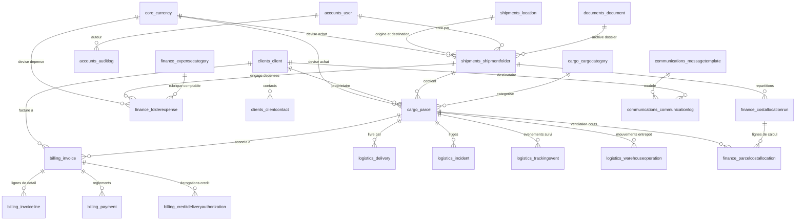

# Dictionnaire de Données — LCK Services SARL

> **Projet** : Plateforme Intégrée de Gestion du Transit et Groupage Maritime & Aérien  
> **Organisation** : LCK Services SARL — Douala, Cameroun  
> **Moteur de Base de Données** : MySQL 8+ (Moteur relationnel InnoDB, Jeu de caractères `utf8mb4_unicode_ci`)  
> **Architecture ORM** : Django 5.x — Intégrité référentielle native, Clés primaires auto-incrémentées BigInt

---

## 1. Introduction et Règles Générales de Modélisation

Le présent dictionnaire recense de manière exhaustive l'ensemble des entités relationnelles, des colonnes physiques, des types de données, des contraintes d'intégrité et des règles métier appliquées dans la base de données relationnelle `lck_services_db`.

### Conventions Techniques et Normes
- **Préfixes de tables** : Chaque table physique adopte le format `<nom_app>_<nom_modele>` en minuscules (ex: `shipments_shipmentfolder`).
- **Identifiants uniques** : Chaque entité dispose d'une clé primaire technique `id` de type `BIGINT AUTO_INCREMENT` (`BigAutoField`).
- **Horodatage universel** : Chaque modèle métier hérite des colonnes d'audit `created_at` (création) et `updated_at` (dernière modification).
- **Précision monétaire** : Tous les montants financiers sont exprimés en FCFA ou devises associées avec des types `DECIMAL(12, 2)` ou `DECIMAL(14, 2)` afin d'éviter tout arrondi en virgule flottante.
- **Volumes et Poids** : Les métriques volumétriques ($m^3$) utilisent `DECIMAL(10, 4)` et les poids ($kg$) utilisent `DECIMAL(10, 2)`.

---

## 2. Diagramme des Entités et Relations (ERD Global)

---

## 3. Répertoire Synthétique des Tables de la Base

| N° | Domaine Métier | Entité / Modèle | Table Physique MySQL | Rôle Métier Principal |
|:--:|---|---|---|---|
| 1 | **Configuration & Référentiel Général** | `CompanySetting` | `core_companysetting` | Paramètre société |
| 2 | **Configuration & Référentiel Général** | `Currency` | `core_currency` | Devise |
| 3 | **Comptes, Sécurité & Traçabilité** | `User` | `accounts_user` | Utilisateur |
| 4 | **Comptes, Sécurité & Traçabilité** | `AuditLog` | `accounts_auditlog` | Journal d'activité |
| 5 | **Comptes, Sécurité & Traçabilité** | `BackupRecord` | `accounts_backuprecord` | Sauvegarde |
| 6 | **Répertoire Clients & Partenaires** | `Client` | `clients_client` | Client |
| 7 | **Répertoire Clients & Partenaires** | `ClientContact` | `clients_clientcontact` | Contact client |
| 8 | **Dossiers de Groupage & Localisations** | `Location` | `shipments_location` | Port / aéroport |
| 9 | **Dossiers de Groupage & Localisations** | `ShipmentFolder` | `shipments_shipmentfolder` | Dossier d'expédition |
| 10 | **Marchandises, Colis & Colisage** | `CargoCategory` | `cargo_cargocategory` | Catégorie de marchandise |
| 11 | **Marchandises, Colis & Colisage** | `Parcel` | `cargo_parcel` | Colis / marchandise |
| 12 | **Logistique, Entrepôts, Suivi & Incidents** | `TrackingEvent` | `logistics_trackingevent` | Mouvement de tracking |
| 13 | **Logistique, Entrepôts, Suivi & Incidents** | `WarehouseOperation` | `logistics_warehouseoperation` | Opération d'entrepôt |
| 14 | **Logistique, Entrepôts, Suivi & Incidents** | `Delivery` | `logistics_delivery` | Livraison |
| 15 | **Logistique, Entrepôts, Suivi & Incidents** | `Incident` | `logistics_incident` | Incident / litige |
| 16 | **Dépenses, Débours & Affectations Financières** | `ExpenseCategory` | `finance_expensecategory` | Catégorie de dépense |
| 17 | **Dépenses, Débours & Affectations Financières** | `FolderExpense` | `finance_folderexpense` | Dépense de dossier |
| 18 | **Dépenses, Débours & Affectations Financières** | `CostAllocationRun` | `finance_costallocationrun` | Répartition financière |
| 19 | **Dépenses, Débours & Affectations Financières** | `ParcelCostAllocation` | `finance_parcelcostallocation` | Ligne de répartition colis |
| 20 | **Facturation, Règlements & Crédits** | `Invoice` | `billing_invoice` | Facture |
| 21 | **Facturation, Règlements & Crédits** | `InvoiceLine` | `billing_invoiceline` | Ligne de facture |
| 22 | **Facturation, Règlements & Crédits** | `Payment` | `billing_payment` | Paiement / reçu |
| 23 | **Facturation, Règlements & Crédits** | `CreditDeliveryAuthorization` | `billing_creditdeliveryauthorization` | Autorisation de livraison à crédit |
| 24 | **Gestion Électronique des Documents (GED)** | `Document` | `documents_document` | Document |
| 25 | **Communications Clients & WhatsApp** | `MessageTemplate` | `communications_messagetemplate` | Modèle de message |
| 26 | **Communications Clients & WhatsApp** | `CommunicationLog` | `communications_communicationlog` | Message envoyé |

---

## 4. Spécification Détaillée des Attributs par Entité

### 4.1 Domaine : Configuration & Référentiel Général (`core`)

#### Entité : `CompanySetting` — Table : `core_companysetting`
> **Rôle métier** : Paramètres généraux de LCK Services SARL pour les en-têtes documentaires et la facturation.

| Nom Colonne | Libellé Métier | Type Django | Type MySQL | Nullable | Valeur par Défaut | Contraintes / Relations | Description / Énumérations |
|---|---|---|---|:---:|---|---|---|
| `id` | ID | `BigAutoField` | `bigint AUTO_INCREMENT` | NON | `-` | **PK** | - |
| `created_at` | Créé le | `DateTimeField` | `datetime(6)` | NON | `-` | - | - |
| `updated_at` | Modifié le | `DateTimeField` | `datetime(6)` | NON | `-` | - | - |
| `name` | Raison sociale | `CharField` | `varchar(150)` | NON | `'LCK Services SARL'` | - | - |
| `slogan` | Domaine / Slogan | `CharField` | `varchar(255)` | NON | `'Transit, Transport International & Groupage Maritime et Aérien'` | - | - |
| `niu` | NIU / Identifiant fiscal | `CharField` | `varchar(80)` | NON | `''` | - | - |
| `rccm` | RCCM | `CharField` | `varchar(80)` | NON | `''` | - | - |
| `phone` | Téléphone principal | `CharField` | `varchar(50)` | NON | `'+237 600 00 00 00'` | - | - |
| `whatsapp` | Numéro WhatsApp | `CharField` | `varchar(50)` | NON | `'+237 600 00 00 00'` | - | - |
| `email` | Email | `CharField` | `varchar(254)` | NON | `'contact@lckservices.com'` | - | - |
| `address` | Adresse | `CharField` | `varchar(255)` | NON | `'Douala, Cameroun'` | - | - |
| `city` | Ville | `CharField` | `varchar(100)` | NON | `'Douala'` | - | - |
| `country` | Pays | `CharField` | `varchar(100)` | NON | `'Cameroun'` | - | - |
| `default_currency` | Devise principale | `CharField` | `varchar(10)` | NON | `'FCFA'` | - | - |
| `bank_details` | Coordonnées bancaires / Mobile Money | `TextField` | `longtext` | NON | `''` | - | - |
| `invoice_footer_note` | Mentions de pied de facture | `TextField` | `longtext` | NON | `'Les marchandises voyagent aux risques et périls du destinataire sauf assurance souscrite. Merci de votre confiance.'` | - | - |
| `logo` | Logo société | `FileField` | `varchar(100)` | OUI | `-` | - | - |

#### Entité : `Currency` — Table : `core_currency`
> **Rôle métier** : Référentiel des devises avec taux de conversion vers le FCFA.

| Nom Colonne | Libellé Métier | Type Django | Type MySQL | Nullable | Valeur par Défaut | Contraintes / Relations | Description / Énumérations |
|---|---|---|---|:---:|---|---|---|
| `id` | ID | `BigAutoField` | `bigint AUTO_INCREMENT` | NON | `-` | **PK** | - |
| `created_at` | Créé le | `DateTimeField` | `datetime(6)` | NON | `-` | - | - |
| `updated_at` | Modifié le | `DateTimeField` | `datetime(6)` | NON | `-` | - | - |
| `code` | Code devise | `CharField` | `varchar(10)` | NON | `-` | **UNIQUE** | - |
| `name` | Libellé | `CharField` | `varchar(80)` | NON | `-` | - | - |
| `symbol` | Symbole | `CharField` | `varchar(15)` | NON | `'FCFA'` | - | - |
| `rate_to_fcfa` | Taux vers FCFA (1 unité = X FCFA) | `DecimalField` | `numeric(14, 4)` | NON | `Decimal('1.0000')` | - | - |
| `is_base` | Devise principale (FCFA) | `BooleanField` | `bool` | NON | `False` | - | - |
| `is_active` | Active | `BooleanField` | `bool` | NON | `True` | - | - |

### 4.2 Domaine : Comptes, Sécurité & Traçabilité (`accounts`)

#### Entité : `User` — Table : `accounts_user`
> **Rôle métier** : Compte utilisateur de la plateforme LCK Services SARL.
Conformément à la section 3 du cahier des charges :
- Un seul rôle fonctionnel : 'Utilisateur' (mêmes droits fonctionnels sur tous les modules).
- 'is_access_admin' identifie le compte administrateur initial chargé de gérer les accès/comptes.

| Nom Colonne | Libellé Métier | Type Django | Type MySQL | Nullable | Valeur par Défaut | Contraintes / Relations | Description / Énumérations |
|---|---|---|---|:---:|---|---|---|
| `id` | ID | `BigAutoField` | `bigint AUTO_INCREMENT` | NON | `-` | **PK** | - |
| `password` | mot de passe | `CharField` | `varchar(128)` | NON | `-` | - | - |
| `last_login` | dernière connexion | `DateTimeField` | `datetime(6)` | OUI | `-` | - | - |
| `is_superuser` | statut super-utilisateur | `BooleanField` | `bool` | NON | `False` | - | Précise que l’utilisateur possède toutes les permissions sans les assigner explicitement. |
| `username` | nom d’utilisateur | `CharField` | `varchar(150)` | NON | `-` | **UNIQUE** | Requis. 150 caractères maximum. Uniquement des lettres, nombres et les caractères « @ », « . », « + », « - » et « _ ». |
| `first_name` | prénom | `CharField` | `varchar(150)` | NON | `-` | - | - |
| `last_name` | nom | `CharField` | `varchar(150)` | NON | `-` | - | - |
| `email` | adresse électronique | `CharField` | `varchar(254)` | NON | `-` | - | - |
| `is_staff` | statut équipe | `BooleanField` | `bool` | NON | `False` | - | Précise si l’utilisateur peut se connecter à ce site d'administration. |
| `is_active` | actif | `BooleanField` | `bool` | NON | `True` | - | Précise si l’utilisateur doit être considéré comme actif. Décochez ceci plutôt que de supprimer le compte. |
| `date_joined` | date d’inscription | `DateTimeField` | `datetime(6)` | NON | `now` | - | - |
| `phone` | Téléphone | `CharField` | `varchar(40)` | NON | `''` | - | - |
| `job_title` | Fonction / Poste | `CharField` | `varchar(100)` | NON | `'Agent Opérationnel'` | - | - |
| `is_access_admin` | Gestionnaire des accès (Compte administrateur initial) | `BooleanField` | `bool` | NON | `False` | - | Permet de créer, modifier, activer et désactiver les comptes utilisateurs. |
| `created_at` | Date de création | `DateTimeField` | `datetime(6)` | NON | `-` | - | - |
| `updated_at` | Dernière mise à jour | `DateTimeField` | `datetime(6)` | NON | `-` | - | - |
| `groups` | groupes | `ManyToManyField` | `ManyToManyField` | NON | `-` | FK &rarr; `auth_group` () | Les groupes dont fait partie cet utilisateur. Celui-ci obtient tous les droits de tous les groupes auxquels il appartient. |
| `user_permissions` | permissions de l’utilisateur | `ManyToManyField` | `ManyToManyField` | NON | `-` | FK &rarr; `auth_permission` () | Permissions spécifiques à cet utilisateur. |

#### Entité : `AuditLog` — Table : `accounts_auditlog`
> **Rôle métier** : Journalisation chronologique de toutes les opérations sensibles et métiers.

| Nom Colonne | Libellé Métier | Type Django | Type MySQL | Nullable | Valeur par Défaut | Contraintes / Relations | Description / Énumérations |
|---|---|---|---|:---:|---|---|---|
| `id` | ID | `BigAutoField` | `bigint AUTO_INCREMENT` | NON | `-` | **PK** | - |
| `user_id` | Utilisateur | `ForeignKey` | `bigint` | OUI | `-` | FK &rarr; `accounts_user` (SET_NULL) | - |
| `username_snapshot` | Identifiant | `CharField` | `varchar(150)` | NON | `''` | - | - |
| `action` | Action | `CharField` | `varchar(30)` | NON | `-` | - | Valeurs autorisées : **`LOGIN`** : Connexion, **`LOGOUT`** : Déconnexion, **`LOGIN_FAILED`** : Échec de connexion, **`CREATE`** : Création, **`UPDATE`** : Modification, **`DELETE`** : Suppression, **`STATUS`** : Changement de statut, **`ALLOCATION`** : Répartition des frais, **`PAYMENT`** : Enregistrement paiement, **`CREDIT_AUTH`** : Autorisation crédit, **`DOCUMENT`** : Génération / Import document, **`WHATSAPP`** : Partage communication, **`EXPORT`** : Exportation rapport, **`BACKUP`** : Sauvegarde système, **`ACCOUNT`** : Gestion de compte |
| `module` | Module | `CharField` | `varchar(80)` | NON | `-` | - | - |
| `object_repr` | Élément concerné | `CharField` | `varchar(255)` | NON | `-` | - | - |
| `object_id` | ID Objet | `CharField` | `varchar(64)` | NON | `''` | - | - |
| `details` | Détails de l'opération | `TextField` | `longtext` | NON | `''` | - | - |
| `ip_address` | Adresse IP | `GenericIPAddressField` | `char(39)` | OUI | `-` | - | - |
| `created_at` | Date & Heure | `DateTimeField` | `datetime(6)` | NON | `-` | - | - |

#### Entité : `BackupRecord` — Table : `accounts_backuprecord`
> **Rôle métier** : Historique des sauvegardes de la base de données et des documents.

| Nom Colonne | Libellé Métier | Type Django | Type MySQL | Nullable | Valeur par Défaut | Contraintes / Relations | Description / Énumérations |
|---|---|---|---|:---:|---|---|---|
| `id` | ID | `BigAutoField` | `bigint AUTO_INCREMENT` | NON | `-` | **PK** | - |
| `reference` | Référence sauvegarde | `CharField` | `varchar(60)` | NON | `-` | **UNIQUE** | - |
| `archive_file` | Fichier d'archive (.zip) | `FileField` | `varchar(100)` | NON | `-` | - | - |
| `size_bytes` | Taille (octets) | `BigIntegerField` | `bigint` | NON | `0` | - | - |
| `includes_media` | Inclut les documents (media) | `BooleanField` | `bool` | NON | `True` | - | - |
| `records_count` | Nombre d'enregistrements | `PositiveIntegerField` | `integer UNSIGNED` | NON | `0` | - | - |
| `notes` | Observation | `CharField` | `varchar(255)` | NON | `''` | - | - |
| `created_by_id` | Réalisée par | `ForeignKey` | `bigint` | OUI | `-` | FK &rarr; `accounts_user` (SET_NULL) | - |
| `created_at` | Date de sauvegarde | `DateTimeField` | `datetime(6)` | NON | `-` | - | - |

### 4.3 Domaine : Répertoire Clients & Partenaires (`clients`)

#### Entité : `Client` — Table : `clients_client`
> **Rôle métier** : Client(id, created_at, updated_at, code, client_type, name, tax_id, phone, whatsapp, email, address, city, country, credit_allowed, credit_limit_fcfa, notes, is_active)

| Nom Colonne | Libellé Métier | Type Django | Type MySQL | Nullable | Valeur par Défaut | Contraintes / Relations | Description / Énumérations |
|---|---|---|---|:---:|---|---|---|
| `id` | ID | `BigAutoField` | `bigint AUTO_INCREMENT` | NON | `-` | **PK** | - |
| `created_at` | Créé le | `DateTimeField` | `datetime(6)` | NON | `-` | - | - |
| `updated_at` | Modifié le | `DateTimeField` | `datetime(6)` | NON | `-` | - | - |
| `code` | Code client | `CharField` | `varchar(30)` | NON | `-` | **UNIQUE** | - |
| `client_type` | Type de client | `CharField` | `varchar(20)` | NON | `'ENTREPRISE'` | - | Valeurs autorisées : **`ENTREPRISE`** : Entreprise / Société, **`PARTICULIER`** : Particulier / Commerçant |
| `name` | Nom complet / Raison sociale | `CharField` | `varchar(180)` | NON | `-` | - | - |
| `tax_id` | NIU / RCCM / Pièce d'identité | `CharField` | `varchar(80)` | NON | `''` | - | - |
| `phone` | Téléphone principal | `CharField` | `varchar(40)` | NON | `-` | - | - |
| `whatsapp` | Numéro WhatsApp | `CharField` | `varchar(40)` | NON | `''` | - | - |
| `email` | Adresse e-mail | `CharField` | `varchar(254)` | NON | `''` | - | - |
| `address` | Adresse | `CharField` | `varchar(255)` | NON | `''` | - | - |
| `city` | Ville | `CharField` | `varchar(100)` | NON | `'Douala'` | - | - |
| `country` | Pays | `CharField` | `varchar(100)` | NON | `'Cameroun'` | - | - |
| `credit_allowed` | Éligible au crédit | `BooleanField` | `bool` | NON | `False` | - | - |
| `credit_limit_fcfa` | Plafond de crédit indicatif (FCFA) | `DecimalField` | `numeric(14, 2)` | NON | `Decimal('0.00')` | - | - |
| `notes` | Notes / Instructions spéciales | `TextField` | `longtext` | NON | `''` | - | - |
| `is_active` | Client actif | `BooleanField` | `bool` | NON | `True` | - | - |

#### Entité : `ClientContact` — Table : `clients_clientcontact`
> **Rôle métier** : Interlocuteurs et contacts additionnels rattachés à un client.

| Nom Colonne | Libellé Métier | Type Django | Type MySQL | Nullable | Valeur par Défaut | Contraintes / Relations | Description / Énumérations |
|---|---|---|---|:---:|---|---|---|
| `id` | ID | `BigAutoField` | `bigint AUTO_INCREMENT` | NON | `-` | **PK** | - |
| `created_at` | Créé le | `DateTimeField` | `datetime(6)` | NON | `-` | - | - |
| `updated_at` | Modifié le | `DateTimeField` | `datetime(6)` | NON | `-` | - | - |
| `client_id` | Client | `ForeignKey` | `bigint` | NON | `-` | FK &rarr; `clients_client` (CASCADE) | - |
| `full_name` | Nom complet | `CharField` | `varchar(150)` | NON | `-` | - | - |
| `role` | Fonction / Lien | `CharField` | `varchar(100)` | NON | `''` | - | - |
| `phone` | Téléphone | `CharField` | `varchar(40)` | NON | `-` | - | - |
| `whatsapp` | WhatsApp | `CharField` | `varchar(40)` | NON | `''` | - | - |
| `email` | Email | `CharField` | `varchar(254)` | NON | `''` | - | - |
| `is_primary` | Contact principal | `BooleanField` | `bool` | NON | `False` | - | - |

### 4.4 Domaine : Dossiers de Groupage & Localisations (`shipments`)

#### Entité : `Location` — Table : `shipments_location`
> **Rôle métier** : Port maritime, aéroport international ou plateforme logistique.

| Nom Colonne | Libellé Métier | Type Django | Type MySQL | Nullable | Valeur par Défaut | Contraintes / Relations | Description / Énumérations |
|---|---|---|---|:---:|---|---|---|
| `id` | ID | `BigAutoField` | `bigint AUTO_INCREMENT` | NON | `-` | **PK** | - |
| `created_at` | Créé le | `DateTimeField` | `datetime(6)` | NON | `-` | - | - |
| `updated_at` | Modifié le | `DateTimeField` | `datetime(6)` | NON | `-` | - | - |
| `name` | Nom du port / aéroport | `CharField` | `varchar(150)` | NON | `-` | - | - |
| `code` | Code UN/LOCODE ou IATA | `CharField` | `varchar(20)` | NON | `-` | **UNIQUE** | - |
| `city` | Ville | `CharField` | `varchar(100)` | NON | `-` | - | - |
| `country` | Pays | `CharField` | `varchar(100)` | NON | `-` | - | - |
| `location_type` | Type | `CharField` | `varchar(20)` | NON | `'MIXTE'` | - | Valeurs autorisées : **`PORT`** : Port Maritime, **`AEROPORT`** : Aéroport International, **`MIXTE`** : Plateforme / Ville Mixte |
| `is_active` | Actif | `BooleanField` | `bool` | NON | `True` | - | - |

#### Entité : `ShipmentFolder` — Table : `shipments_shipmentfolder`
> **Rôle métier** : Dossier d'expédition ou de groupage maritime / aérien.

| Nom Colonne | Libellé Métier | Type Django | Type MySQL | Nullable | Valeur par Défaut | Contraintes / Relations | Description / Énumérations |
|---|---|---|---|:---:|---|---|---|
| `id` | ID | `BigAutoField` | `bigint AUTO_INCREMENT` | NON | `-` | **PK** | - |
| `created_at` | Créé le | `DateTimeField` | `datetime(6)` | NON | `-` | - | - |
| `updated_at` | Modifié le | `DateTimeField` | `datetime(6)` | NON | `-` | - | - |
| `reference` | Référence dossier | `CharField` | `varchar(35)` | NON | `-` | **UNIQUE** | - |
| `title` | Intitulé / Campagne de groupage | `CharField` | `varchar(180)` | NON | `''` | - | - |
| `transport_mode` | Mode de transport | `CharField` | `varchar(15)` | NON | `'MARITIME'` | - | Valeurs autorisées : **`MARITIME`** : Maritime, **`AERIEN`** : Aérien |
| `operation_type` | Type d'opération | `CharField` | `varchar(20)` | NON | `'GROUPAGE'` | - | Valeurs autorisées : **`GROUPAGE`** : Groupage (LCL / Consolidé), **`COMPLET`** : Conteneur complet (FCL) / Lot dédié, **`TRANSIT`** : Transit & Dédouanement direct |
| `status` | Statut du dossier | `CharField` | `varchar(25)` | NON | `'OUVERT'` | - | Valeurs autorisées : **`BROUILLON`** : Brouillon, **`OUVERT`** : Ouvert (Collecte & Réception), **`CHARGE`** : Chargé / Empoté, **`EN_TRANSIT`** : En transit international, **`ARRIVE`** : Arrivé au port / aéroport, **`DEDOUANEMENT`** : En formalités douanières, **`DISPONIBLE_ENTREPOT`** : Réceptionné en entrepôt (Dégroupé), **`CLOTURE`** : Clôturé, **`ANNULE`** : Annulé |
| `origin_id` | Port / Aéroport de départ | `ForeignKey` | `bigint` | NON | `-` | FK &rarr; `shipments_location` (PROTECT) | - |
| `destination_id` | Port / Aéroport d'arrivée | `ForeignKey` | `bigint` | NON | `-` | FK &rarr; `shipments_location` (PROTECT) | - |
| `shipping_line` | Compagnie maritime | `CharField` | `varchar(120)` | NON | `''` | - | - |
| `vessel_name` | Nom du navire | `CharField` | `varchar(120)` | NON | `''` | - | - |
| `voyage_number` | N° de voyage | `CharField` | `varchar(60)` | NON | `''` | - | - |
| `container_number` | N° de conteneur | `CharField` | `varchar(60)` | NON | `''` | - | - |
| `container_type` | Type de conteneur | `CharField` | `varchar(15)` | NON | `''` | - | Valeurs autorisées : **``** : Non applicable / Aérien, **`20GP`** : 20 Pieds (20' GP), **`40GP`** : 40 Pieds (40' GP), **`40HC`** : 40 HC (High Cube), **`LCL`** : Groupage partagé (LCL), **`VRAC`** : Vrac / Roro, **`AUTRE`** : Autre |
| `seal_number` | N° de plomb / scellé | `CharField` | `varchar(60)` | NON | `''` | - | - |
| `bl_number` | N° Connaissement (B/L) | `CharField` | `varchar(80)` | NON | `''` | - | - |
| `airline_name` | Compagnie aérienne | `CharField` | `varchar(120)` | NON | `''` | - | - |
| `flight_number` | N° de vol | `CharField` | `varchar(60)` | NON | `''` | - | - |
| `awb_number` | N° Lettre de transport aérien (AWB) | `CharField` | `varchar(80)` | NON | `''` | - | - |
| `forwarder` | Transitaire / Armateur | `CharField` | `varchar(150)` | NON | `''` | - | - |
| `etd` | Date de départ prévue (ETD) | `DateField` | `date` | OUI | `-` | - | - |
| `atd` | Date de départ réelle (ATD) | `DateField` | `date` | OUI | `-` | - | - |
| `eta` | Date d'arrivée prévue (ETA) | `DateField` | `date` | OUI | `-` | - | - |
| `ata` | Date d'arrivée réelle (ATA) | `DateField` | `date` | OUI | `-` | - | - |
| `closed_at` | Date de clôture | `DateTimeField` | `datetime(6)` | OUI | `-` | - | - |
| `default_rate_per_cbm` | Tarif indicatif au m³ (FCFA) | `DecimalField` | `numeric(14, 2)` | NON | `Decimal('0.00')` | - | - |
| `default_rate_per_kg` | Tarif indicatif au kg (FCFA) | `DecimalField` | `numeric(14, 2)` | NON | `Decimal('0.00')` | - | - |
| `notes` | Observations opérationnelles | `TextField` | `longtext` | NON | `''` | - | - |
| `created_by_id` | Créé par | `ForeignKey` | `bigint` | OUI | `-` | FK &rarr; `accounts_user` (SET_NULL) | - |

### 4.5 Domaine : Marchandises, Colis & Colisage (`cargo`)

#### Entité : `CargoCategory` — Table : `cargo_cargocategory`
> **Rôle métier** : Classification des marchandises (Électronique, Textile, Pièces détachées, etc.).

| Nom Colonne | Libellé Métier | Type Django | Type MySQL | Nullable | Valeur par Défaut | Contraintes / Relations | Description / Énumérations |
|---|---|---|---|:---:|---|---|---|
| `id` | ID | `BigAutoField` | `bigint AUTO_INCREMENT` | NON | `-` | **PK** | - |
| `created_at` | Créé le | `DateTimeField` | `datetime(6)` | NON | `-` | - | - |
| `updated_at` | Modifié le | `DateTimeField` | `datetime(6)` | NON | `-` | - | - |
| `name` | Catégorie de marchandise | `CharField` | `varchar(120)` | NON | `-` | **UNIQUE** | - |
| `code` | Code interne / SH indicatif | `CharField` | `varchar(30)` | NON | `''` | - | - |
| `is_fragile_or_special` | Manutention fragile / spéciale | `BooleanField` | `bool` | NON | `False` | - | - |
| `description` | Description | `CharField` | `varchar(255)` | NON | `''` | - | - |

#### Entité : `Parcel` — Table : `cargo_parcel`
> **Rôle métier** : Colis ou lot de marchandises associé à un client et un dossier d'expédition.

| Nom Colonne | Libellé Métier | Type Django | Type MySQL | Nullable | Valeur par Défaut | Contraintes / Relations | Description / Énumérations |
|---|---|---|---|:---:|---|---|---|
| `id` | ID | `BigAutoField` | `bigint AUTO_INCREMENT` | NON | `-` | **PK** | - |
| `created_at` | Créé le | `DateTimeField` | `datetime(6)` | NON | `-` | - | - |
| `updated_at` | Modifié le | `DateTimeField` | `datetime(6)` | NON | `-` | - | - |
| `parcel_code` | Code unique colis | `CharField` | `varchar(35)` | NON | `-` | **UNIQUE** | - |
| `verification_token` | Jeton QR de vérification | `UUIDField` | `char(32)` | NON | `uuid4` | **UNIQUE** | - |
| `folder_id` | Dossier d'expédition | `ForeignKey` | `bigint` | NON | `-` | FK &rarr; `shipments_shipmentfolder` (CASCADE) | - |
| `client_id` | Client destinataire | `ForeignKey` | `bigint` | NON | `-` | FK &rarr; `clients_client` (PROTECT) | - |
| `category_id` | Classification marchandise | `ForeignKey` | `bigint` | OUI | `-` | FK &rarr; `cargo_cargocategory` (SET_NULL) | - |
| `description` | Désignation de la marchandise | `CharField` | `varchar(255)` | NON | `-` | - | - |
| `item_type` | Type d'article | `CharField` | `varchar(20)` | NON | `'MARCHANDISE'` | - | Valeurs autorisées : **`MARCHANDISE`** : Marchandise / Colis, **`VEHICULE`** : Véhicule, **`PIECE`** : Pièce détachée, **`AUTRE`** : Autre |
| `chassis_number` | Numéro de châssis (si véhicule) | `CharField` | `varchar(80)` | NON | `''` | - | - |
| `contract_file` | Contrat / Document attaché | `FileField` | `varchar(100)` | OUI | `-` | - | - |
| `supplier_name` | Fournisseur / Expéditeur d'origine | `CharField` | `varchar(150)` | NON | `''` | - | - |
| `supplier_tracking` | Réf. fournisseur / Tracking local | `CharField` | `varchar(100)` | NON | `''` | - | - |
| `packaging_type` | Conditionnement | `CharField` | `varchar(25)` | NON | `'CARTON'` | - | Valeurs autorisées : **`CARTON`** : Carton(s), **`PALETTE`** : Palette(s), **`CAISSE`** : Caisse(s) bois/métal, **`BALLOT`** : Ballot(s), **`SAC`** : Sac(s), **`FUT`** : Fût(s) / Bidon(s), **`COLIS_HORS_GABARIT`** : Hors gabarit / Machine, **`AUTRE`** : Autre emballage |
| `quantity` | Nombre d'unités / colis | `PositiveIntegerField` | `integer UNSIGNED` | NON | `1` | - | - |
| `weight_kg` | Poids total brut (kg) | `DecimalField` | `numeric(12, 3)` | NON | `Decimal('0.000')` | - | - |
| `length_cm` | Longueur unitaire (cm) | `DecimalField` | `numeric(10, 2)` | NON | `Decimal('0.00')` | - | - |
| `width_cm` | Largeur unitaire (cm) | `DecimalField` | `numeric(10, 2)` | NON | `Decimal('0.00')` | - | - |
| `height_cm` | Hauteur unitaire (cm) | `DecimalField` | `numeric(10, 2)` | NON | `Decimal('0.00')` | - | - |
| `manual_volume` | Saisie manuelle du volume m³ | `BooleanField` | `bool` | NON | `False` | - | Cochez uniquement si le volume total m³ est mesuré globalement sans dimensions L×l×H unitaires. |
| `volume_cbm` | Volume total (m³) | `DecimalField` | `numeric(12, 4)` | NON | `Decimal('0.0000')` | - | - |
| `declared_value` | Valeur déclarée | `DecimalField` | `numeric(14, 2)` | NON | `Decimal('0.00')` | - | - |
| `declared_currency_id` | Devise valeur déclarée | `ForeignKey` | `bigint` | NON | `-` | FK &rarr; `core_currency` (PROTECT) | - |
| `exchange_rate` | Taux appliqué vers FCFA | `DecimalField` | `numeric(14, 4)` | NON | `Decimal('0.0000')` | - | - |
| `declared_value_fcfa` | Valeur déclarée (FCFA) | `DecimalField` | `numeric(15, 2)` | NON | `Decimal('0.00')` | - | - |
| `allocated_cost_fcfa` | Coût de revient réparti (FCFA) | `DecimalField` | `numeric(14, 2)` | NON | `Decimal('0.00')` | - | - |
| `suggested_price_fcfa` | Montant commercial calculé (FCFA) | `DecimalField` | `numeric(14, 2)` | NON | `Decimal('0.00')` | - | - |
| `paid_amount_fcfa` | Montant encaissé sur cet article (FCFA) | `DecimalField` | `numeric(14, 2)` | NON | `Decimal('0.00')` | - | - |
| `status` | Statut du colis | `CharField` | `varchar(25)` | NON | `'RECU_ORIGINE'` | - | Valeurs autorisées : **`RECU_ORIGINE`** : Réceptionné à l'origine, **`CHARGE`** : Chargé / Empoté, **`EN_TRANSIT`** : En transit, **`ARRIVE`** : Arrivé destination, **`DISPONIBLE_ENTREPOT`** : Disponible en entrepôt, **`LIVRE`** : Livré au client, **`LITIGE`** : En incident / Litige |
| `storage_location` | Emplacement entrepôt / Travée | `CharField` | `varchar(80)` | NON | `''` | - | - |
| `notes` | Remarques / État à réception | `TextField` | `longtext` | NON | `''` | - | - |
| `created_by_id` | Enregistré par | `ForeignKey` | `bigint` | OUI | `-` | FK &rarr; `accounts_user` (SET_NULL) | - |

### 4.6 Domaine : Logistique, Entrepôts, Suivi & Incidents (`logistics`)

#### Entité : `TrackingEvent` — Table : `logistics_trackingevent`
> **Rôle métier** : Événement chronologique de suivi d'acheminement (dossier ou colis).

| Nom Colonne | Libellé Métier | Type Django | Type MySQL | Nullable | Valeur par Défaut | Contraintes / Relations | Description / Énumérations |
|---|---|---|---|:---:|---|---|---|
| `id` | ID | `BigAutoField` | `bigint AUTO_INCREMENT` | NON | `-` | **PK** | - |
| `created_at` | Créé le | `DateTimeField` | `datetime(6)` | NON | `-` | - | - |
| `updated_at` | Modifié le | `DateTimeField` | `datetime(6)` | NON | `-` | - | - |
| `folder_id` | Dossier d'expédition | `ForeignKey` | `bigint` | NON | `-` | FK &rarr; `shipments_shipmentfolder` (CASCADE) | - |
| `parcel_id` | Colis spécifique (optionnel si global dossier) | `ForeignKey` | `bigint` | OUI | `-` | FK &rarr; `cargo_parcel` (CASCADE) | - |
| `stage` | Étape d'acheminement | `CharField` | `varchar(30)` | NON | `-` | - | Valeurs autorisées : **`RECEPTION_ORIGINE`** : Réception entrepôt d'origine, **`CONTROLE_EMBALLAGE`** : Contrôle, pesée & étiquetage, **`CHARGEMENT`** : Chargement / Empotage conteneur ou palette, **`DEPART`** : Départ international (Navire / Vol), **`TRANSBORDEMENT`** : Escale / Transbordement, **`ARRIVEE_PORT_AERO`** : Arrivée au port / aéroport de destination, **`DEDOUANEMENT`** : Opérations de transit & dédouanement, **`RECEPTION_ENTREPOT`** : Réception & dégroupage en entrepôt LCK, **`DISPONIBLE`** : Mise à disposition pour enlèvement/livraison, **`LIVRAISON`** : Livraison effectuée au client, **`INCIDENT`** : Incident / Alerte logistique |
| `status_before` | Statut avant | `CharField` | `varchar(60)` | NON | `''` | - | - |
| `status_after` | Statut après | `CharField` | `varchar(60)` | NON | `''` | - | - |
| `location_text` | Lieu / Localisation | `CharField` | `varchar(150)` | NON | `-` | - | - |
| `event_date` | Date et heure du mouvement | `DateTimeField` | `datetime(6)` | NON | `now` | - | - |
| `description` | Détails / Commentaire opérationnel | `TextField` | `longtext` | NON | `''` | - | - |
| `recorded_by_id` | Enregistré par | `ForeignKey` | `bigint` | OUI | `-` | FK &rarr; `accounts_user` (SET_NULL) | - |

#### Entité : `WarehouseOperation` — Table : `logistics_warehouseoperation`
> **Rôle métier** : Opérations physiques de réception origine, chargement/empotage et réception entrepôt destination.

| Nom Colonne | Libellé Métier | Type Django | Type MySQL | Nullable | Valeur par Défaut | Contraintes / Relations | Description / Énumérations |
|---|---|---|---|:---:|---|---|---|
| `id` | ID | `BigAutoField` | `bigint AUTO_INCREMENT` | NON | `-` | **PK** | - |
| `created_at` | Créé le | `DateTimeField` | `datetime(6)` | NON | `-` | - | - |
| `updated_at` | Modifié le | `DateTimeField` | `datetime(6)` | NON | `-` | - | - |
| `reference` | N° Opération | `CharField` | `varchar(35)` | NON | `-` | **UNIQUE** | - |
| `operation_type` | Type d'opération | `CharField` | `varchar(30)` | NON | `-` | - | Valeurs autorisées : **`RECEPTION_ORIGINE`** : Réception à l'entrepôt d'origine, **`CHARGEMENT`** : Opération de chargement / Empotage, **`RECEPTION_DESTINATION`** : Arrivée & Réception en entrepôt de destination (Dépotage) |
| `folder_id` | Dossier concerné | `ForeignKey` | `bigint` | NON | `-` | FK &rarr; `shipments_shipmentfolder` (CASCADE) | - |
| `warehouse_name` | Entrepôt / Quai / Terminal | `CharField` | `varchar(150)` | NON | `-` | - | - |
| `operation_date` | Date & Heure | `DateTimeField` | `datetime(6)` | NON | `now` | - | - |
| `parcels_checked_count` | Nombre de colis pointés | `PositiveIntegerField` | `integer UNSIGNED` | NON | `0` | - | - |
| `total_weight_checked_kg` | Poids total constaté (kg) | `DecimalField` | `numeric(12, 3)` | NON | `Decimal('0.000')` | - | - |
| `condition_status` | État constaté | `CharField` | `varchar(20)` | NON | `'CONFORME'` | - | Valeurs autorisées : **`CONFORME`** : Conforme — Bon état apparent, **`ECART_QTE`** : Écart de quantité constaté, **`ENDOMMAGE`** : Emballage abîmé / Avarie partielle, **`RESERVE`** : Réception sous réserve |
| `notes` | Observations / Pointage contradictoire | `TextField` | `longtext` | NON | `''` | - | - |
| `operator_id` | Agent / Magasinier | `ForeignKey` | `bigint` | OUI | `-` | FK &rarr; `accounts_user` (SET_NULL) | - |

#### Entité : `Delivery` — Table : `logistics_delivery`
> **Rôle métier** : Bon de livraison / Sortie de marchandises remise au client.

| Nom Colonne | Libellé Métier | Type Django | Type MySQL | Nullable | Valeur par Défaut | Contraintes / Relations | Description / Énumérations |
|---|---|---|---|:---:|---|---|---|
| `id` | ID | `BigAutoField` | `bigint AUTO_INCREMENT` | NON | `-` | **PK** | - |
| `created_at` | Créé le | `DateTimeField` | `datetime(6)` | NON | `-` | - | - |
| `updated_at` | Modifié le | `DateTimeField` | `datetime(6)` | NON | `-` | - | - |
| `delivery_number` | N° Bon de livraison | `CharField` | `varchar(35)` | NON | `-` | **UNIQUE** | - |
| `verification_token` | Jeton QR | `UUIDField` | `char(32)` | NON | `uuid4` | **UNIQUE** | - |
| `folder_id` | Dossier d'expédition | `ForeignKey` | `bigint` | NON | `-` | FK &rarr; `shipments_shipmentfolder` (PROTECT) | - |
| `client_id` | Client | `ForeignKey` | `bigint` | NON | `-` | FK &rarr; `clients_client` (PROTECT) | - |
| `invoice_id` | Facture associée | `ForeignKey` | `bigint` | OUI | `-` | FK &rarr; `billing_invoice` (SET_NULL) | - |
| `credit_authorization_id` | Autorisation de livraison à crédit | `ForeignKey` | `bigint` | OUI | `-` | FK &rarr; `billing_creditdeliveryauthorization` (SET_NULL) | - |
| `delivery_mode` | Mode de remise | `CharField` | `varchar(25)` | NON | `'ENLEVEMENT_ENTREPOT'` | - | Valeurs autorisées : **`ENLEVEMENT_ENTREPOT`** : Enlèvement sur site (Entrepôt LCK), **`LIVRAISON_DOMICILE`** : Livraison à l'adresse du client |
| `delivery_address` | Lieu de remise / Adresse | `CharField` | `varchar(255)` | NON | `''` | - | - |
| `recipient_name` | Nom du réceptionnaire | `CharField` | `varchar(150)` | NON | `-` | - | - |
| `recipient_phone` | Téléphone du réceptionnaire | `CharField` | `varchar(40)` | NON | `''` | - | - |
| `recipient_id_number` | N° CNI / Passeport réceptionnaire | `CharField` | `varchar(80)` | NON | `''` | - | - |
| `delivered_at` | Date et heure de livraison | `DateTimeField` | `datetime(6)` | NON | `now` | - | - |
| `notes` | Réserves éventuelles / Observations | `TextField` | `longtext` | NON | `''` | - | - |
| `delivered_by_id` | Délivré par | `ForeignKey` | `bigint` | OUI | `-` | FK &rarr; `accounts_user` (SET_NULL) | - |
| `parcels` | Colis livrés | `ManyToManyField` | `ManyToManyField` | NON | `-` | FK &rarr; `cargo_parcel` () | - |

#### Entité : `Incident` — Table : `logistics_incident`
> **Rôle métier** : Gestion des incidents, avaries, manquants et litiges (Section 2.5).

| Nom Colonne | Libellé Métier | Type Django | Type MySQL | Nullable | Valeur par Défaut | Contraintes / Relations | Description / Énumérations |
|---|---|---|---|:---:|---|---|---|
| `id` | ID | `BigAutoField` | `bigint AUTO_INCREMENT` | NON | `-` | **PK** | - |
| `created_at` | Créé le | `DateTimeField` | `datetime(6)` | NON | `-` | - | - |
| `updated_at` | Modifié le | `DateTimeField` | `datetime(6)` | NON | `-` | - | - |
| `reference` | Référence incident | `CharField` | `varchar(35)` | NON | `-` | **UNIQUE** | - |
| `folder_id` | Dossier concerné | `ForeignKey` | `bigint` | NON | `-` | FK &rarr; `shipments_shipmentfolder` (CASCADE) | - |
| `parcel_id` | Colis concerné | `ForeignKey` | `bigint` | OUI | `-` | FK &rarr; `cargo_parcel` (SET_NULL) | - |
| `client_id` | Client impacté | `ForeignKey` | `bigint` | OUI | `-` | FK &rarr; `clients_client` (SET_NULL) | - |
| `incident_type` | Nature de l'incident | `CharField` | `varchar(25)` | NON | `'AVARIE'` | - | Valeurs autorisées : **`AVARIE`** : Avarie / Marchandise endommagée, **`MANQUANT`** : Perte partielle ou colis manquant, **`RETARD`** : Retard d'acheminement majeur, **`BLOCAGE_DOUANE`** : Blocage / Inspection douanière, **`LITIGE_CLIENT`** : Litige commercial / Réclamation client, **`AUTRE`** : Autre incident |
| `severity` | Gravité | `CharField` | `varchar(15)` | NON | `'MOYENNE'` | - | Valeurs autorisées : **`FAIBLE`** : Faible, **`MOYENNE`** : Moyenne, **`CRITIQUE`** : Critique |
| `status` | Statut | `CharField` | `varchar(15)` | NON | `'EN_COURS'` | - | Valeurs autorisées : **`EN_COURS`** : Ouvert / En cours de traitement, **`RESOLU`** : Résolu / Indemnisé, **`CLOS`** : Clôturé sans suite |
| `title` | Objet de l'incident | `CharField` | `varchar(180)` | NON | `-` | - | - |
| `description` | Constat détaillé | `TextField` | `longtext` | NON | `-` | - | - |
| `estimated_damage_fcfa` | Préjudice estimé (FCFA) | `DecimalField` | `numeric(14, 2)` | NON | `Decimal('0.00')` | - | - |
| `compensation_fcfa` | Montant dédommagement / prise en charge (FCFA) | `DecimalField` | `numeric(14, 2)` | NON | `Decimal('0.00')` | - | - |
| `resolution_notes` | Actions correctives / Résolution | `TextField` | `longtext` | NON | `''` | - | - |
| `attachment` | Photo / Constat joint | `FileField` | `varchar(100)` | OUI | `-` | - | - |
| `reported_at` | Date du constat | `DateTimeField` | `datetime(6)` | NON | `now` | - | - |
| `resolved_at` | Date de résolution | `DateTimeField` | `datetime(6)` | OUI | `-` | - | - |
| `reported_by_id` | Déclaré par | `ForeignKey` | `bigint` | OUI | `-` | FK &rarr; `accounts_user` (SET_NULL) | - |

### 4.7 Domaine : Dépenses, Débours & Affectations Financières (`finance`)

#### Entité : `ExpenseCategory` — Table : `finance_expensecategory`
> **Rôle métier** : Classification des frais opérationnels et douaniers.

| Nom Colonne | Libellé Métier | Type Django | Type MySQL | Nullable | Valeur par Défaut | Contraintes / Relations | Description / Énumérations |
|---|---|---|---|:---:|---|---|---|
| `id` | ID | `BigAutoField` | `bigint AUTO_INCREMENT` | NON | `-` | **PK** | - |
| `created_at` | Créé le | `DateTimeField` | `datetime(6)` | NON | `-` | - | - |
| `updated_at` | Modifié le | `DateTimeField` | `datetime(6)` | NON | `-` | - | - |
| `name` | Catégorie de frais | `CharField` | `varchar(120)` | NON | `-` | **UNIQUE** | - |
| `code` | Code analytique | `CharField` | `varchar(25)` | NON | `''` | - | - |
| `description` | Description | `CharField` | `varchar(255)` | NON | `''` | - | - |

#### Entité : `FolderExpense` — Table : `finance_folderexpense`
> **Rôle métier** : Dépense engagée sur un dossier d'expédition, avec support multi-devises et justificatif.

| Nom Colonne | Libellé Métier | Type Django | Type MySQL | Nullable | Valeur par Défaut | Contraintes / Relations | Description / Énumérations |
|---|---|---|---|:---:|---|---|---|
| `id` | ID | `BigAutoField` | `bigint AUTO_INCREMENT` | NON | `-` | **PK** | - |
| `created_at` | Créé le | `DateTimeField` | `datetime(6)` | NON | `-` | - | - |
| `updated_at` | Modifié le | `DateTimeField` | `datetime(6)` | NON | `-` | - | - |
| `reference` | Référence dépense | `CharField` | `varchar(35)` | NON | `-` | **UNIQUE** | - |
| `folder_id` | Dossier d'expédition | `ForeignKey` | `bigint` | NON | `-` | FK &rarr; `shipments_shipmentfolder` (CASCADE) | - |
| `category_id` | Catégorie de frais | `ForeignKey` | `bigint` | NON | `-` | FK &rarr; `finance_expensecategory` (PROTECT) | - |
| `label` | Libellé de la dépense | `CharField` | `varchar(200)` | NON | `-` | - | - |
| `vendor_name` | Prestataire / Bénéficiaire | `CharField` | `varchar(150)` | NON | `''` | - | - |
| `expense_date` | Date de la dépense | `DateField` | `date` | NON | `now` | - | - |
| `amount_original` | Montant en devise | `DecimalField` | `numeric(14, 2)` | NON | `-` | - | - |
| `currency_id` | Devise | `ForeignKey` | `bigint` | NON | `-` | FK &rarr; `core_currency` (PROTECT) | - |
| `exchange_rate` | Taux appliqué vers FCFA | `DecimalField` | `numeric(14, 4)` | NON | `Decimal('0.0000')` | - | - |
| `amount_fcfa` | Montant converti (FCFA) | `DecimalField` | `numeric(15, 2)` | NON | `Decimal('0.00')` | - | - |
| `receipt_file` | Pièce justificative | `FileField` | `varchar(100)` | OUI | `-` | - | - |
| `is_paid` | Frais déjà payé | `BooleanField` | `bool` | NON | `True` | - | - |
| `payment_date` | Date du paiement | `DateField` | `date` | OUI | `-` | - | - |
| `is_allocatable` | Inclure dans la répartition des coûts | `BooleanField` | `bool` | NON | `True` | - | Décochez uniquement s'il s'agit d'une charge non imputable aux colis. |
| `notes` | Observations | `TextField` | `longtext` | NON | `''` | - | - |
| `recorded_by_id` | Enregistré par | `ForeignKey` | `bigint` | OUI | `-` | FK &rarr; `accounts_user` (SET_NULL) | - |

#### Entité : `CostAllocationRun` — Table : `finance_costallocationrun`
> **Rôle métier** : Historique horodaté d'une opération de répartition des coûts et calcul de rentabilité d'un dossier.

| Nom Colonne | Libellé Métier | Type Django | Type MySQL | Nullable | Valeur par Défaut | Contraintes / Relations | Description / Énumérations |
|---|---|---|---|:---:|---|---|---|
| `id` | ID | `BigAutoField` | `bigint AUTO_INCREMENT` | NON | `-` | **PK** | - |
| `created_at` | Créé le | `DateTimeField` | `datetime(6)` | NON | `-` | - | - |
| `updated_at` | Modifié le | `DateTimeField` | `datetime(6)` | NON | `-` | - | - |
| `reference` | Référence répartition | `CharField` | `varchar(35)` | NON | `-` | **UNIQUE** | - |
| `folder_id` | Dossier d'expédition | `ForeignKey` | `bigint` | NON | `-` | FK &rarr; `shipments_shipmentfolder` (CASCADE) | - |
| `allocation_method` | Clé de répartition | `CharField` | `varchar(15)` | NON | `'VOLUME'` | - | Valeurs autorisées : **`VOLUME`** : Au prorata du volume (m³), **`WEIGHT`** : Au prorata du poids (kg), **`VALUE`** : Au prorata de la valeur déclarée (FCFA), **`FLAT`** : Répartition forfaitaire (parts égales / manuel) |
| `margin_type` | Mode de marge commerciale | `CharField` | `varchar(20)` | NON | `'PERCENT'` | - | Valeurs autorisées : **`PERCENT`** : Marge en pourcentage (%) sur le coût, **`FIXED_PARCEL`** : Forfait de marge fixe par colis (FCFA), **`TARIFF_UNIT`** : Tarification commerciale au m³ / kg |
| `margin_value` | Valeur de marge (% ou FCFA / Tarif unitaire) | `DecimalField` | `numeric(14, 2)` | NON | `Decimal('25.00')` | - | - |
| `total_expenses_fcfa` | Total dépenses à répartir (FCFA) | `DecimalField` | `numeric(15, 2)` | NON | `Decimal('0.00')` | - | - |
| `total_allocated_cost_fcfa` | Total coûts imputés (FCFA) | `DecimalField` | `numeric(15, 2)` | NON | `Decimal('0.00')` | - | - |
| `total_commercial_fcfa` | Total commercial recommandé (FCFA) | `DecimalField` | `numeric(15, 2)` | NON | `Decimal('0.00')` | - | - |
| `expected_profit_fcfa` | Rentabilité prévisionnelle (FCFA) | `DecimalField` | `numeric(15, 2)` | NON | `Decimal('0.00')` | - | - |
| `is_active_run` | Répartition active du dossier | `BooleanField` | `bool` | NON | `True` | - | - |
| `notes` | Commentaire financier | `TextField` | `longtext` | NON | `''` | - | - |
| `created_by_id` | Calculée par | `ForeignKey` | `bigint` | OUI | `-` | FK &rarr; `accounts_user` (SET_NULL) | - |

#### Entité : `ParcelCostAllocation` — Table : `finance_parcelcostallocation`
> **Rôle métier** : Quote-part détaillée d'un colis lors d'une répartition financière, avec ajustement manuel.

| Nom Colonne | Libellé Métier | Type Django | Type MySQL | Nullable | Valeur par Défaut | Contraintes / Relations | Description / Énumérations |
|---|---|---|---|:---:|---|---|---|
| `id` | ID | `BigAutoField` | `bigint AUTO_INCREMENT` | NON | `-` | **PK** | - |
| `created_at` | Créé le | `DateTimeField` | `datetime(6)` | NON | `-` | - | - |
| `updated_at` | Modifié le | `DateTimeField` | `datetime(6)` | NON | `-` | - | - |
| `run_id` | Répartition | `ForeignKey` | `bigint` | NON | `-` | FK &rarr; `finance_costallocationrun` (CASCADE) | - |
| `parcel_id` | Colis | `ForeignKey` | `bigint` | NON | `-` | FK &rarr; `cargo_parcel` (CASCADE) | - |
| `basis_quantity` | Valeur de base (m³/kg/FCFA) | `DecimalField` | `numeric(15, 4)` | NON | `Decimal('0.0000')` | - | - |
| `share_percent` | Quote-part (%) | `DecimalField` | `numeric(8, 4)` | NON | `Decimal('0.0000')` | - | - |
| `theoretical_cost_fcfa` | Coût automatique (FCFA) | `DecimalField` | `numeric(14, 2)` | NON | `Decimal('0.00')` | - | - |
| `manual_adjustment_fcfa` | Ajustement manuel coût (FCFA) | `DecimalField` | `numeric(14, 2)` | NON | `Decimal('0.00')` | - | - |
| `final_cost_fcfa` | Coût de revient retenu (FCFA) | `DecimalField` | `numeric(14, 2)` | NON | `Decimal('0.00')` | - | - |
| `margin_amount_fcfa` | Marge commerciale (FCFA) | `DecimalField` | `numeric(14, 2)` | NON | `Decimal('0.00')` | - | - |
| `final_price_fcfa` | Montant à facturer (FCFA) | `DecimalField` | `numeric(14, 2)` | NON | `Decimal('0.00')` | - | - |

### 4.8 Domaine : Facturation, Règlements & Crédits (`billing`)

#### Entité : `Invoice` — Table : `billing_invoice`
> **Rôle métier** : Facture Proforma ou Définitive libellée en FCFA.

| Nom Colonne | Libellé Métier | Type Django | Type MySQL | Nullable | Valeur par Défaut | Contraintes / Relations | Description / Énumérations |
|---|---|---|---|:---:|---|---|---|
| `id` | ID | `BigAutoField` | `bigint AUTO_INCREMENT` | NON | `-` | **PK** | - |
| `created_at` | Créé le | `DateTimeField` | `datetime(6)` | NON | `-` | - | - |
| `updated_at` | Modifié le | `DateTimeField` | `datetime(6)` | NON | `-` | - | - |
| `number` | Numéro de facture | `CharField` | `varchar(35)` | NON | `-` | **UNIQUE** | - |
| `verification_token` | Jeton QR d'authenticité | `UUIDField` | `char(32)` | NON | `uuid4` | **UNIQUE** | - |
| `invoice_type` | Type de facture | `CharField` | `varchar(15)` | NON | `'DEFINITIVE'` | - | Valeurs autorisées : **`PROFORMA`** : Facture Proforma, **`DEFINITIVE`** : Facture Définitive |
| `status` | Statut | `CharField` | `varchar(25)` | NON | `'EMISE'` | - | Valeurs autorisées : **`PROFORMA`** : Proforma (Devis / Pré-facture), **`EMISE`** : Émise — En attente de paiement, **`PARTIELLEMENT_PAYEE`** : Partiellement payée, **`PAYEE`** : Payée intégralement, **`ANNULEE`** : Annulée |
| `client_id` | Client | `ForeignKey` | `bigint` | NON | `-` | FK &rarr; `clients_client` (PROTECT) | - |
| `folder_id` | Dossier d'expédition | `ForeignKey` | `bigint` | OUI | `-` | FK &rarr; `shipments_shipmentfolder` (SET_NULL) | - |
| `source_proforma_id` | Proforma d'origine | `OneToOneField` | `bigint` | OUI | `-` | **UNIQUE**, FK &rarr; `billing_invoice` (SET_NULL) | - |
| `issue_date` | Date d'émission | `DateField` | `date` | NON | `now` | - | - |
| `due_date` | Date d'échéance | `DateField` | `date` | OUI | `-` | - | - |
| `subtotal_fcfa` | Sous-total HT (FCFA) | `DecimalField` | `numeric(15, 2)` | NON | `Decimal('0.00')` | - | - |
| `discount_fcfa` | Remise commerciale (FCFA) | `DecimalField` | `numeric(14, 2)` | NON | `Decimal('0.00')` | - | - |
| `tax_rate_percent` | Taux TVA / Taxe (%) | `DecimalField` | `numeric(5, 2)` | NON | `Decimal('0.00')` | - | - |
| `tax_amount_fcfa` | Montant Taxe (FCFA) | `DecimalField` | `numeric(14, 2)` | NON | `Decimal('0.00')` | - | - |
| `total_amount_fcfa` | Net à payer TTC (FCFA) | `DecimalField` | `numeric(15, 2)` | NON | `Decimal('0.00')` | - | - |
| `paid_amount_fcfa` | Montant encaissé (FCFA) | `DecimalField` | `numeric(15, 2)` | NON | `Decimal('0.00')` | - | - |
| `notes` | Conditions / Notes figurant sur la facture | `TextField` | `longtext` | NON | `''` | - | - |
| `created_by_id` | Émise par | `ForeignKey` | `bigint` | OUI | `-` | FK &rarr; `accounts_user` (SET_NULL) | - |

#### Entité : `InvoiceLine` — Table : `billing_invoiceline`
> **Rôle métier** : Ligne de facturation (colis de groupage, prestation douanière, livraison, frais dossier).

| Nom Colonne | Libellé Métier | Type Django | Type MySQL | Nullable | Valeur par Défaut | Contraintes / Relations | Description / Énumérations |
|---|---|---|---|:---:|---|---|---|
| `id` | ID | `BigAutoField` | `bigint AUTO_INCREMENT` | NON | `-` | **PK** | - |
| `invoice_id` | Facture | `ForeignKey` | `bigint` | NON | `-` | FK &rarr; `billing_invoice` (CASCADE) | - |
| `parcel_id` | Colis rattaché | `ForeignKey` | `bigint` | OUI | `-` | FK &rarr; `cargo_parcel` (SET_NULL) | - |
| `description` | Désignation | `CharField` | `varchar(255)` | NON | `-` | - | - |
| `quantity` | Quantité / Volume / Poids | `DecimalField` | `numeric(12, 4)` | NON | `Decimal('1.0000')` | - | - |
| `unit_label` | Unité | `CharField` | `varchar(20)` | NON | `'forfait'` | - | - |
| `unit_price_fcfa` | Prix unitaire (FCFA) | `DecimalField` | `numeric(14, 2)` | NON | `Decimal('0.00')` | - | - |
| `line_total_fcfa` | Montant total ligne (FCFA) | `DecimalField` | `numeric(15, 2)` | NON | `Decimal('0.00')` | - | - |

#### Entité : `Payment` — Table : `billing_payment`
> **Rôle métier** : Règlement partiel ou total d'une facture donnant lieu à un Reçu de paiement numéroté.

| Nom Colonne | Libellé Métier | Type Django | Type MySQL | Nullable | Valeur par Défaut | Contraintes / Relations | Description / Énumérations |
|---|---|---|---|:---:|---|---|---|
| `id` | ID | `BigAutoField` | `bigint AUTO_INCREMENT` | NON | `-` | **PK** | - |
| `created_at` | Créé le | `DateTimeField` | `datetime(6)` | NON | `-` | - | - |
| `updated_at` | Modifié le | `DateTimeField` | `datetime(6)` | NON | `-` | - | - |
| `receipt_number` | Numéro de reçu | `CharField` | `varchar(35)` | NON | `-` | **UNIQUE** | - |
| `verification_token` | Jeton QR Reçu | `UUIDField` | `char(32)` | NON | `uuid4` | **UNIQUE** | - |
| `invoice_id` | Facture réglée | `ForeignKey` | `bigint` | NON | `-` | FK &rarr; `billing_invoice` (CASCADE) | - |
| `parcel_id` | Colis rattaché | `ForeignKey` | `bigint` | OUI | `-` | FK &rarr; `cargo_parcel` (SET_NULL) | - |
| `client_id` | Client | `ForeignKey` | `bigint` | NON | `-` | FK &rarr; `clients_client` (PROTECT) | - |
| `payment_date` | Date de paiement | `DateField` | `date` | NON | `now` | - | - |
| `amount_fcfa` | Montant encaissé (FCFA) | `DecimalField` | `numeric(15, 2)` | NON | `-` | - | - |
| `payment_method` | Mode de paiement | `CharField` | `varchar(20)` | NON | `'ESPECES'` | - | Valeurs autorisées : **`ESPECES`** : Espèces (Caisse), **`MOBILE_MONEY`** : Mobile Money (Orange Money / MTN MoMo), **`VIREMENT`** : Virement bancaire, **`CHEQUE`** : Chèque bancaire, **`AUTRE`** : Autre mode de règlement |
| `transaction_reference` | Réf. transaction / N° Chèque / Bordereau | `CharField` | `varchar(100)` | NON | `''` | - | - |
| `notes` | Observation | `CharField` | `varchar(255)` | NON | `''` | - | - |
| `received_by_id` | Encaissé par | `ForeignKey` | `bigint` | OUI | `-` | FK &rarr; `accounts_user` (SET_NULL) | - |

#### Entité : `CreditDeliveryAuthorization` — Table : `billing_creditdeliveryauthorization`
> **Rôle métier** : Autorisation exceptionnelle de livraison à crédit lorsque la facture n'est pas encore intégralement soldée.

| Nom Colonne | Libellé Métier | Type Django | Type MySQL | Nullable | Valeur par Défaut | Contraintes / Relations | Description / Énumérations |
|---|---|---|---|:---:|---|---|---|
| `id` | ID | `BigAutoField` | `bigint AUTO_INCREMENT` | NON | `-` | **PK** | - |
| `created_at` | Créé le | `DateTimeField` | `datetime(6)` | NON | `-` | - | - |
| `updated_at` | Modifié le | `DateTimeField` | `datetime(6)` | NON | `-` | - | - |
| `reference` | N° Autorisation | `CharField` | `varchar(35)` | NON | `-` | **UNIQUE** | - |
| `client_id` | Client bénéficiaire | `ForeignKey` | `bigint` | NON | `-` | FK &rarr; `clients_client` (PROTECT) | - |
| `invoice_id` | Facture concernée | `ForeignKey` | `bigint` | NON | `-` | FK &rarr; `billing_invoice` (CASCADE) | - |
| `folder_id` | Dossier d'expédition | `ForeignKey` | `bigint` | OUI | `-` | FK &rarr; `shipments_shipmentfolder` (SET_NULL) | - |
| `authorized_balance_fcfa` | Solde autorisé à crédit (FCFA) | `DecimalField` | `numeric(15, 2)` | NON | `-` | - | - |
| `promised_due_date` | Échéance de règlement engagée | `DateField` | `date` | NON | `-` | - | - |
| `reason` | Motif / Garantie commerciale | `TextField` | `longtext` | NON | `-` | - | - |
| `status` | Statut | `CharField` | `varchar(20)` | NON | `'ACTIVE'` | - | Valeurs autorisées : **`ACTIVE`** : Active — Livraison autorisée, **`REGULARISEE`** : Régularisée (Facture soldée), **`REVOQUEE`** : Révoquée / Expirée |
| `approved_by_id` | Accordée par | `ForeignKey` | `bigint` | OUI | `-` | FK &rarr; `accounts_user` (SET_NULL) | - |

### 4.9 Domaine : Gestion Électronique des Documents (GED) (`documents`)

#### Entité : `Document` — Table : `documents_document`
> **Rôle métier** : Document(id, created_at, updated_at, reference, doc_type, title, external_number, file, folder, parcel, client, invoice, notes, uploaded_by)

| Nom Colonne | Libellé Métier | Type Django | Type MySQL | Nullable | Valeur par Défaut | Contraintes / Relations | Description / Énumérations |
|---|---|---|---|:---:|---|---|---|
| `id` | ID | `BigAutoField` | `bigint AUTO_INCREMENT` | NON | `-` | **PK** | - |
| `created_at` | Créé le | `DateTimeField` | `datetime(6)` | NON | `-` | - | - |
| `updated_at` | Modifié le | `DateTimeField` | `datetime(6)` | NON | `-` | - | - |
| `reference` | Référence GED | `CharField` | `varchar(35)` | NON | `-` | **UNIQUE** | - |
| `doc_type` | Type de document | `CharField` | `varchar(30)` | NON | `'AUTRE'` | - | Valeurs autorisées : **`BL_MARITIME`** : Connaissement maritime (B/L), **`AWB_AERIEN`** : Lettre de transport aérien (AWB), **`CONTRAT_TRANSPORT`** : Contrat de transport, **`PACKING_LIST`** : Packing List / Liste de colisage, **`FACTURE_FOURNISSEUR`** : Facture commerciale marchandise, **`DECLARATION_DOUANE`** : Déclaration / Document douanier, **`JUSTIFICATIF_DEPENSE`** : Justificatif de dépense, **`MANIFESTE`** : Manifeste de chargement, **`BON_LIVRAISON_SIGNE`** : Bon de livraison signé, **`AUTRE`** : Autre pièce |
| `title` | Titre du document | `CharField` | `varchar(200)` | NON | `-` | - | - |
| `external_number` | N° officiel (B/L, AWB, Déclaration...) | `CharField` | `varchar(100)` | NON | `''` | - | - |
| `file` | Fichier numérique | `FileField` | `varchar(100)` | NON | `-` | - | - |
| `folder_id` | Dossier associé | `ForeignKey` | `bigint` | OUI | `-` | FK &rarr; `shipments_shipmentfolder` (CASCADE) | - |
| `parcel_id` | Colis associé | `ForeignKey` | `bigint` | OUI | `-` | FK &rarr; `cargo_parcel` (SET_NULL) | - |
| `client_id` | Client associé | `ForeignKey` | `bigint` | OUI | `-` | FK &rarr; `clients_client` (SET_NULL) | - |
| `invoice_id` | Facture associée | `ForeignKey` | `bigint` | OUI | `-` | FK &rarr; `billing_invoice` (SET_NULL) | - |
| `notes` | Commentaire | `CharField` | `varchar(255)` | NON | `''` | - | - |
| `uploaded_by_id` | Importé par | `ForeignKey` | `bigint` | OUI | `-` | FK &rarr; `accounts_user` (SET_NULL) | - |

### 4.10 Domaine : Communications Clients & WhatsApp (`communications`)

#### Entité : `MessageTemplate` — Table : `communications_messagetemplate`
> **Rôle métier** : Modèle de message pré-formaté pour WhatsApp / Notification client.

| Nom Colonne | Libellé Métier | Type Django | Type MySQL | Nullable | Valeur par Défaut | Contraintes / Relations | Description / Énumérations |
|---|---|---|---|:---:|---|---|---|
| `id` | ID | `BigAutoField` | `bigint AUTO_INCREMENT` | NON | `-` | **PK** | - |
| `created_at` | Créé le | `DateTimeField` | `datetime(6)` | NON | `-` | - | - |
| `updated_at` | Modifié le | `DateTimeField` | `datetime(6)` | NON | `-` | - | - |
| `code` | Code modèle | `SlugField` | `varchar(50)` | NON | `-` | **UNIQUE** | - |
| `name` | Intitulé du modèle | `CharField` | `varchar(150)` | NON | `-` | - | - |
| `category` | Catégorie | `CharField` | `varchar(25)` | NON | `'GENERAL'` | - | Valeurs autorisées : **`RECEPTION`** : Confirmation de réception colis, **`DEPART`** : Avis de départ expédition, **`ARRIVEE`** : Avis d'arrivée & disponibilité entrepôt, **`FACTURATION`** : Envoi de facture Proforma / Définitive, **`RELANCE`** : Relance de solde impayé, **`LIVRAISON`** : Confirmation de livraison, **`GENERAL`** : Information générale |
| `body_template` | Contenu du message | `TextField` | `longtext` | NON | `-` | - | Variables disponibles : {client_nom}, {dossier_ref}, {mode_transport}, {origine}, {destination}, {eta}, {colis_code}, {volume_m3}, {poids_kg}, {facture_num}, {montant_total}, {montant_paye}, {solde_restant}, {lien_document}, {societe} |
| `is_active` | Actif | `BooleanField` | `bool` | NON | `True` | - | - |

#### Entité : `CommunicationLog` — Table : `communications_communicationlog`
> **Rôle métier** : Historique des messages générés et partagés aux clients via WhatsApp.

| Nom Colonne | Libellé Métier | Type Django | Type MySQL | Nullable | Valeur par Défaut | Contraintes / Relations | Description / Énumérations |
|---|---|---|---|:---:|---|---|---|
| `id` | ID | `BigAutoField` | `bigint AUTO_INCREMENT` | NON | `-` | **PK** | - |
| `created_at` | Créé le | `DateTimeField` | `datetime(6)` | NON | `-` | - | - |
| `updated_at` | Modifié le | `DateTimeField` | `datetime(6)` | NON | `-` | - | - |
| `client_id` | Client destinataire | `ForeignKey` | `bigint` | NON | `-` | FK &rarr; `clients_client` (CASCADE) | - |
| `folder_id` | Dossier lié | `ForeignKey` | `bigint` | OUI | `-` | FK &rarr; `shipments_shipmentfolder` (SET_NULL) | - |
| `parcel_id` | Colis lié | `ForeignKey` | `bigint` | OUI | `-` | FK &rarr; `cargo_parcel` (SET_NULL) | - |
| `invoice_id` | Facture liée | `ForeignKey` | `bigint` | OUI | `-` | FK &rarr; `billing_invoice` (SET_NULL) | - |
| `channel` | Canal | `CharField` | `varchar(20)` | NON | `'WHATSAPP'` | - | Valeurs autorisées : **`WHATSAPP`** : WhatsApp, **`MESSAGE_DIRECT`** : Copie / Message direct |
| `recipient_phone` | Numéro WhatsApp utilisé | `CharField` | `varchar(40)` | NON | `-` | - | - |
| `subject` | Objet | `CharField` | `varchar(160)` | NON | `''` | - | - |
| `message_body` | Contenu du message généré | `TextField` | `longtext` | NON | `-` | - | - |
| `sent_by_id` | Généré par | `ForeignKey` | `bigint` | OUI | `-` | FK &rarr; `accounts_user` (SET_NULL) | - |

---

## 5. Matrice des Relations et Règles de Suppression

| Table Source | Colonne FK | Table Cible | Clé Cible | Comportement `ON DELETE` | Règle Métier |
|---|---|---|---|---|---|
| `shipments_shipmentfolder` | `origin_id` | `shipments_location` | `id` | `PROTECT` | Empêche la suppression d'un port/aéroport d'origine en cours d'utilisation |
| `shipments_shipmentfolder` | `destination_id` | `shipments_location` | `id` | `PROTECT` | Empêche la suppression d'une destination active |
| `shipments_shipmentfolder` | `purchase_currency_id` | `core_currency` | `id` | `PROTECT` | Sécurise la devise de calcul fret maritime/aérien |
| `shipments_shipmentfolder` | `created_by_id` | `accounts_user` | `id` | `SET_NULL` | Préserve l'historique du dossier même si l'agent est supprimé |
| `cargo_parcel` | `folder_id` | `shipments_shipmentfolder` | `id` | `CASCADE` | Un colis appartient obligatoirement à son dossier d'expédition |
| `cargo_parcel` | `client_id` | `clients_client` | `id` | `PROTECT` | Empêche la suppression accidentelle d'un client ayant des marchandises |
| `cargo_parcel` | `category_id` | `cargo_cargocategory` | `id` | `PROTECT` | Sécurise les catégories tarifaires appliquées aux colis |
| `cargo_parcel` | `warehouse_id` | `logistics_warehouse` | `id` | `SET_NULL` | Garde le colis si un entrepôt est reconfiguré |
| `cargo_parcelitem` | `parcel_id` | `cargo_parcel` | `id` | `CASCADE` | La suppression d'un colis supprime l'ensemble de ses lignes d'articles |
| `finance_folderexpense` | `folder_id` | `shipments_shipmentfolder` | `id` | `CASCADE` | Les débours sont rattachés de façon indissociable à leur dossier |
| `finance_folderexpense` | `category_id` | `finance_expensecategory` | `id` | `PROTECT` | Les rubriques de charges comptables sont protégées |
| `finance_folderallocation` | `folder_id` | `shipments_shipmentfolder` | `id` | `CASCADE` | Les clés de ventilation analytique dépendent du dossier |
| `billing_invoice` | `client_id` | `clients_client` | `id` | `PROTECT` | Une facture émise ne peut être rendue orpheline de son client |
| `billing_invoice` | `parcel_id` | `cargo_parcel` | `id` | `CASCADE` | Lie la facture de groupage au lot de marchandises concerné |
| `billing_invoice` | `folder_id` | `shipments_shipmentfolder` | `id` | `CASCADE` | Rattache la facture au conteneur / vol |
| `billing_invoiceitem` | `invoice_id` | `billing_invoice` | `id` | `CASCADE` | Les lignes de facture sont supprimées avec l'en-tête de facture |
| `billing_payment` | `invoice_id` | `billing_invoice` | `id` | `CASCADE` | Règlements rattachés à la facture |
| `billing_payment` | `client_id` | `clients_client` | `id` | `PROTECT` | Traçabilité des encaissements par client |
| `billing_creditauthorization` | `invoice_id` | `billing_invoice` | `id` | `CASCADE` | Dérogation accordée sur la facture d'origine |
| `logistics_delivery` | `parcel_id` | `cargo_parcel` | `id` | `CASCADE` | Bon de sortie/livraison du colis |
| `logistics_incident` | `parcel_id` | `cargo_parcel` | `id` | `CASCADE` | Litige/avarie rattaché au colis |
| `logistics_trackingevent` | `parcel_id` | `cargo_parcel` | `id` | `CASCADE` | Jalons chronologiques d'expédition |
| `documents_document` | `folder_id` / `parcel_id` | Divers | `id` | `CASCADE / SET_NULL` | Fichiers numérisés de la GED |
| `communications_communicationlog` | `client_id` | `clients_client` | `id` | `CASCADE` | Historique des envois WhatsApp |

---

## 6. Index et Optimisations de Performance

- **Recherche plein texte & Codes uniques** :
  - `shipments_shipmentfolder(reference)` : Index UNIQUE pour la recherche rapide des dossiers.
  - `cargo_parcel(parcel_code)` : Index UNIQUE pour la recherche globale et scan de QR codes.
  - `billing_invoice(number)` : Index UNIQUE pour l'archivage légal et comptable.
  - `clients_client(code)` : Index UNIQUE pour l'identification rapide des comptes clients.
- **Index composés et filtres fréquents** :
  - `shipments_shipmentfolder(mode, status, eta)` : Optimise les tableaux de bord opérationnels.
  - `cargo_parcel(folder_id, status)` : Accélère le filtrage des colis par conteneur.
  - `billing_invoice(status, due_date)` : Accélère les relances d'impayés et les balances âgées.
  - `logistics_trackingevent(parcel_id, -event_time)` : Restitution instantanée de la chronologie de suivi.